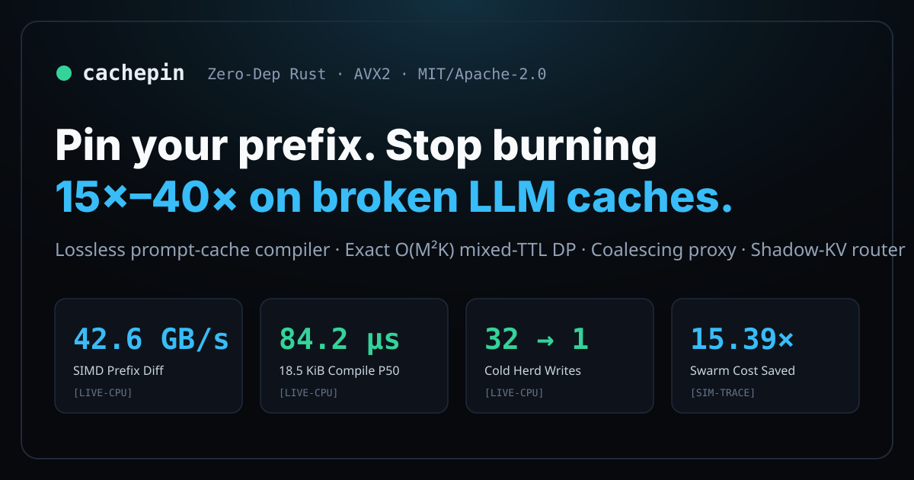

# CachePin

**Find where two LLM requests stop sharing a prompt prefix.** Two agents can use the same runbook and tools but list the tools in different orders. CachePin shows the first differing byte, identifies the changed block, and estimates how much of the next request could be reused if both clients serialized it the same way.

[Compare two prompts in your browser](https://pgg898200-ship-it.github.io/cachepin/#compare) · [Download the CLI](https://github.com/pgg898200-ship-it/cachepin/releases/latest) · [Connect an MCP client](docs/INTEGRATIONS.md#3-native-mcp-server-claude-code-codex-cursor-gemini-cli-opencode)

[](https://pgg898200-ship-it.github.io/cachepin/#compare)

## Try a pair of requests

The [two example requests](examples/prefix-diff/) share a runbook and two tools. The tool order and the final user question differ. From a checkout with the release binary on your PATH, run:

```sh
cachepin diff examples/prefix-diff/a.json examples/prefix-diff/b.json --mode json --provider anthropic --json
```

The v0.2.0 report includes these fields:

```json
{
  "reason": "tool_order_drift",
  "divergence_path": "tools[0]",
  "raw_lcp_bytes": 68,
  "raw_matched_tokens": 0,
  "opt_matched_tokens": 1099,
  "total_tokens": 1113
}
```

The files share 68 literal bytes before the first tool name changes. In CachePin's replay model, sorting the tools and JSON keys raises the matching prefix from 0 to 1,099 estimated tokens for the second request. The different user questions still reach the model. You can run the comparison locally without an API key, model, or GPU. For billing or latency decisions, compare provider-reported usage and timing on your own workload.

## Where it fits

| Your task | Put CachePin here | What comes out |
|---|---|---|
| Diagnose two requests | After your client serializes request JSON, before it calls a model | `cachepin diff a.json b.json --json` reports the first differing byte, likely cause, and modeled reuse. |
| Audit a workload | Offline, alongside a JSONL trace or local Claude Code / Codex logs | `cachepin audit trace.jsonl --json` summarizes observed records and modeled cache behavior. |
| Standardize requests | Between your prompt builder and provider SDK | `cachepin optimize --mode json --no-breakpoints` reads JSON from stdin and writes the transformed request to stdout. |
| Route live traffic | Between the agent and a model API or a pool of vLLM / SGLang backends | The optional reverse proxy forwards requests, can coalesce same-prefix bursts, and exposes `/metrics`. |
| Invoke from an agent | As a local stdio MCP server | Launch `cachepin mcp`, discover its five tools with `tools/list`, and call the one your client needs. |

Start with `--mode json` for key and tool ordering. The `hoist` and `swarm` modes can move volatile values and reorder shared context blocks. Inspect the resulting request and evaluate response quality on representative tasks before using those modes in live traffic.

## Install

Download a Linux or macOS binary from the [release assets](https://github.com/pgg898200-ship-it/cachepin/releases/latest), or build the Rust CLI locally:

```sh
git clone https://github.com/pgg898200-ship-it/cachepin.git
cd cachepin
cargo build --release --locked
./target/release/cachepin diff examples/prefix-diff/a.json examples/prefix-diff/b.json --mode json --provider anthropic --json
```

The Rust crate has zero external crate dependencies. The [installer](scripts/install.sh), [Homebrew formula](Formula/cachepin.rb), [Nix flake](flake.nix), [container](Dockerfile), and [Python binding](python/cachepin/) provide other entry points.

## Measurements

| Workload | Recorded result |
|---|---|
| Compile an 18,535-byte request on an AVX2 CPU | 84.23 µs median, 138.44 µs p99 |
| Proxy a request to a loopback upstream | 219.43 µs median added overhead |
| Send 32 concurrent requests to the local test upstream | 32 cold writes in the baseline, 1 with coalescing |
| Replay a synthetic 32-agent coding workload | 2.24% modeled cache hits before normalization and 98.44% after |

The first three results are local measurements. The last uses a simulated access pattern and pricing profile. [Recorded results](benchmarks/results.json) · [Reproduce the benchmark](scripts/verify.sh) · [Method and implementation](docs/ALGORITHMS.md)

## Integrations and related tools

- [Integration guide](docs/INTEGRATIONS.md) covers Claude Code, Codex, cloud APIs, self-hosted inference, Python and MCP.
- [Official MCP Registry listing](https://registry.modelcontextprotocol.io/v0.1/servers?search=io.github.pgg898200-ship-it%2Fcachepin) includes the versioned desktop extension and its checksum. Registry identifier: `mcp-name: io.github.pgg898200-ship-it/cachepin`.
- [Agent index](llms.txt) points to command syntax, tool schemas, inputs and output fields. [Agent skill](SKILL.md)
- [Prefix Atlas](tools/prefix-atlas/) sizes a prefix cache for a target hit rate. [Open the capacity calculator](https://pgg898200-ship-it.github.io/cachepin/prefix-atlas/).
- [Cutstream](cutstream/) detects stop strings in the gateway's output stream.

[Browse other PGG tools by task](https://github.com/pgg898200-ship-it/backfold/blob/main/docs/PRODUCTS.md).

See the [license file](LICENSE) and [crate metadata](Cargo.toml) for licensing details.
