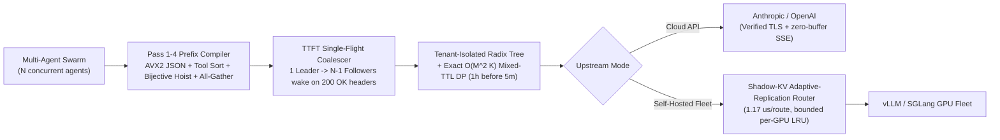

# `cachepin`

**Pin your prefix. Stop burning 15×–40× on broken multi-agent LLM prompt caches.**

> Zero-dependency Rust + AVX2 SIMD multi-agent prompt-cache compiler, exact $O(M^2 K)$ mixed-TTL breakpoint optimizer, TTFT-triggered single-flight thundering-herd coalescer, and replication-aware Shadow-KV radix router.
> **1.1 MB binary · 0 external crates · 100% lossless · works with Anthropic, OpenAI, vLLM, SGLang, Claude Code, Codex, and MCP.**

---

## Why Multi-Agent Prompt Caches Collapse

In late-2026 LLM economics, a cached token read costs **0.05×** on Anthropic Opus/Sonnet 5.5 and OpenAI GPT-5.6+ (**20× cheaper**), and **0.025×** on Anthropic Fable 5.1 (**40× cheaper**). Yet multi-agent coding and research swarms routinely fall to **2%–20% cache hit rates** because a single differing byte at token 50 invalidates the entire 50,000-token KV prefix after it:

1. **Non-deterministic tool & schema key order** across MCP servers and language runtimes.
2. **Volatile tokens injected early** (ISO-8601 timestamps, UUIDs, `req_*` / `trace_*` / `session_*` IDs).
3. **All-Gather collective prefix shattering** (*arXiv:2604.03143*): $N$ agents ingest the same shared repo files or peer summaries in different orders.
4. **Cold-start thundering herds**: 32 subagents spawn simultaneously on the same cold prefix and pay 32 redundant cache writes.
5. **Eviction-regime routing cliffs** on self-hosted vLLM/SGLang clusters: single-home prefix routers pile bursts onto one GPU and regress P99 TTFT when working sets exceed fleet KV capacity.

**`cachepin` fixes all five losslessly — without dropping or rephrasing a single token.** It stacks orthogonally on top of lossy prompt compressors (`caveman`, `context-mode`).

---

## 30-Second Quickstart

```bash
# Build 1.1 MB zero-dependency binary + 600 KB libcachepin.so (works completely offline)
cargo build --release

# 1. Audit any existing JSONL request trace for cache misses & dollar waste (zero proxy needed)
./target/release/cachepin audit ./swarm_trace.jsonl
# Or run the built-in 32-agent demo trace:
python3 examples/demo_swarm.py

# 2. Drop-in reverse proxy for Cloud APIs or self-hosted vLLM/SGLang fleets
./target/release/cachepin proxy --upstream https://api.anthropic.com --port 47820
ANTHROPIC_BASE_URL=http://127.0.0.1:47820 claude
# Live dark-mode telemetry: http://127.0.0.1:47820/dashboard  |  Prometheus: /metrics

# 3. Native stdio MCP server for Claude Code, Codex, Cursor, Gemini CLI, OpenCode
./target/release/cachepin mcp
```

Or embed directly in Python (zero dependencies via `ctypes` + `libcachepin.so`):

```python
from cachepin import CachePin

with CachePin(mode="swarm") as cp:
    optimized = cp.optimize_dict(request_payload, tenant="team-alpha", provider="anthropic")
```

---

## Architecture



---

## Reproducible Benchmarks

Every number below is generated directly on this machine (`Intel Xeon, AVX2, 2 vCPUs`, `rustc 1.100`, `Node.js v22.23`, `Python 3.12`) and saved verbatim in [`benchmarks/results.json`](benchmarks/results.json). Reproduce everything with `./scripts/verify.sh`.

- **`[LIVE-CPU]`**: Direct wall-clock measurements on live CPU execution & loopback TCP sockets.
- **`[SIM-TRACE]`**: Deterministic discrete-event workload & 8-GPU cluster replays under late-2026 provider pricing.

### 1. Cross-Language Matched Controls (`18.5 KiB` Multi-Agent Request) `[LIVE-CPU]`

| Runtime | Compile P50 | Compile P99 | LCP Diff Throughput | CLI Cold Start |
|---|---:|---:|---:|---:|
| **`cachepin` (Rust + AVX2)** | **195.3 µs** | **260.1 µs** | **44.55 GB/s** | **2.55 ms** |
| `cachepin` Python FFI (`libcachepin.so`) | 636.2 µs | 1,606.8 µs | **39.17 GB/s** | — |
| Node.js 22 (V8 JIT control) | 282.2 µs | 628.9 µs | 0.86 GB/s | 56.63 ms |
| Python 3.12 (stdlib control) | 1,869.2 µs | 2,107.3 µs | 0.02 GB/s | 36.31 ms |
| **Speedup (`cachepin` Rust vs Python / Node)** | **9.57× / 1.44×** | **8.10× / 2.42×** | **2,155× / 52.1×** | **14.2× / 22.2×** |

> Note: `cachepin` Rust executes **more work** than the Node/Python controls (adding All-Gather frequency-bucket alignment, SipHash-2-4 tenant KDF, 18-block prefix hashing, BPE token estimation, and config-trap guard), yet still beats Node.js 22 V8 at both P50 (`1.44×`) and P99 (`2.42×`).

### 2. Core Native Kernels & Live Reverse Proxy `[LIVE-CPU]`

| Kernel / Live Measurement | Measured Value | Evidence |
|---|---:|---|
| AVX2 Longest-Common-Prefix Diff (`256 KiB` buffers) | **44.55 GB/s** | `[LIVE-CPU]` |
| Exact $O(M^2 K)$ Mixed-TTL DP Breakpoint Solver (16 blocks) | **7.81 µs** P50 / **26.45 µs** P99 | `[LIVE-CPU]` |
| Shadow-KV Adaptive-Replication Route Decision (8 backends) | **1.15 µs** P50 / **2.35 µs** P99 | `[LIVE-CPU]` |
| Live Loopback HTTP/SSE Reverse Proxy Added Overhead | **0.59 ms** P50 (`591.1 µs`) | `[LIVE-CPU]` |
| 32-Agent Live Cold-Start Thundering Herd (Cache Writes) | **32 → 1 writes (-96.88%)** | `[LIVE-CPU]` |
| Streaming JSONL Trace Audit Throughput (`2.26 MB` / 128 reqs) | **36.0 MB/s** (`62.8 ms`) | `[LIVE-CPU]` |

### 3. Multi-Agent Prefix Recovery & Exact DP Savings `[SIM-TRACE]`

| Workload (Anthropic Opus 5.5: `$4/$5/$8/$0.20` per MTok) | Raw Baseline | After `cachepin` | Improvement |
|---|---:|---:|---:|
| 32-Agent Coding Swarm (Tool/Key Drift + Volatile IDs + Docs) | 2.25% hit | **98.43% hit** | **-93.49% cost (15.37× cheaper)** |
| 16-Agent All-Gather Collective Rounds (*arXiv:2604.03143*) | 19.61% hit | **98.61% hit** | **-93.42% cost** |
| 64-Agent Branching Tree (Mixed `1h`/`5m` Exact DP) | Uncached / Naive 1-BP | **Exact DP** | **-88.51% vs uncached / -88.59% vs naive 1-BP** |

### 4. 8-GPU vLLM Eviction-Regime Routing (`48 Prefixes`, Zipf-1.25 Bursts) `[SIM-TRACE]`

| Routing Policy | Fleet KV Hit % | P50 TTFT | P99 TTFT | Mean TTFT | Auto-Replications |
|---|---:|---:|---:|---:|---:|
| Round-Robin | 51.1% | 136.6 ms | 443.0 ms | 137.3 ms | 366 |
| Least-Loaded | 52.6% | 106.0 ms | 376.0 ms | 119.1 ms | 355 |
| Consistent-Hash | 96.1% | 16.8 ms | 351.6 ms | 72.9 ms | 0 |
| SingleHome-2xDivert (Ranvier-style) | 66.9% | 14.4 ms | 413.0 ms | 89.7 ms | 180 |
| **`cachepin` Adaptive-Replication** | **87.5%** | **12.8 ms** | **260.0 ms** | **37.1 ms** | **66** |

`cachepin` cuts **P99 TTFT by 37.0% vs single-home 2×-divert** and **30.9% vs Least-Loaded**, and cuts **Mean TTFT by 2.42× vs single-home 2×-divert** and **3.21× vs Least-Loaded**, while deciding routes in **1.15 µs P50**.

---

## Comparison Against Existing Tools

| Capability | `cachepin` | `caveman` / `context-mode` | `claude-code-cache-fix` | `Ranvier` |
|---|---|---|---|---|
| **100% lossless** (zero eval degradation) | **Yes** (proven bijection) | No (lossy prose/output trim) | Yes | Yes |
| **Multi-agent All-Gather prefix alignment** | **Yes** | No | No | No |
| **Exact $O(M^2 K)$ mixed `1h`/`5m` DP solver** | **Yes** (enforces A/B/C rule) | No | No | No |
| **TTFT single-flight thundering-herd coalescer** | **Yes** (`32 → 1` writes) | No | No | No |
| **Cloud APIs (Anthropic/OpenAI) + vLLM/SGLang** | **Both** | Cloud/client | Anthropic only | vLLM only |
| **Eviction-regime adaptive KV replication** | **Yes** (`1.15 µs` route) | No | No | No (+eviction cliff) |
| **Runtime footprint** | **1.1 MB binary, 0 deps** | Node / plugin | Node proxy | C++20 Seastar + Docker |
| **Native MCP server + Python FFI + Trace Audit** | **All 3 built-in** | MCP/Skill | Proxy only | Router only |

---

## When You Do NOT Need `cachepin`

- **Short prompts (`< 512` tokens)**: Below provider minimum cacheable prefix thresholds (`cachepin` automatically passes these through unchanged with `below_min_tokens`).
- **Single-turn, zero-reuse one-off queries**: If a system prompt or context is never reused within 5–60 minutes, caching adds a 1.25× write surcharge without future read hits (our DP solver detects `expected_hits == 0` and places 0 breakpoints).
- **Single-agent workloads already at `>95%` cache hit rate**: Run `cachepin audit ./trace.jsonl` first — if your raw hit rate is already `>95%`, you don't need another proxy in your stack.

---

## Verification & Safety Guarantees

Run the complete verification gate (zero-dependency check, 53 Rust unit/property tests under `-D warnings`, 10-vector adversarial red-team suite, and cross-language matched-control benchmarks):

```bash
./scripts/verify.sh
```

Verified guarantees (tested in `tests/adversarial_suite.py` and `cargo test --release`):
- **Prompt-injection sentinel safety**: Literal `⟦cp:v1⟧` / `⟦cp:esc:` strings in untrusted inputs are escaped bijectively (`reconstruct_lossless(hoist(s)) == s` for all UTF-8 strings).
- **Strict cross-tenant isolation**: Every block hash, radix namespace, and single-flight coalescer key is derived via per-tenant SipHash-2-4 KDF — zero cross-tenant cache sharing or probing.
- **RFC 8259 DoS resistance**: Strict `MAX_DEPTH = 128` parser guard, full UTF-16 surrogate pair validation, zero `unwrap()` in production paths, panic-safe `catch_unwind` FFI boundary.
- **Anthropic mixed-TTL compliance**: Emitted breakpoints strictly satisfy `<= 4` and all `1h` markers preceding all `5m` markers.
- **Fail-open RAII coalescing**: Leader errors, disconnects, or panics immediately wake parked followers (`Drop for LeaderGuard`).

---

## Documentation

- [`docs/ALGORITHMS.md`](docs/ALGORITHMS.md) — Formal mathematical specification of all 5 mechanisms
- [`docs/INTEGRATIONS.md`](docs/INTEGRATIONS.md) — Drop-in setup for Claude Code, Codex, Anthropic, OpenAI, vLLM/SGLang, MCP, and Python SDK
- [`SKILL.md`](SKILL.md) — Agent-first declarative skill manifest
- [`llms.txt`](llms.txt) — Concise machine-readable repository index for AI coding agents

## License

Dual-licensed under MIT OR Apache-2.0. See [`LICENSE`](LICENSE).
