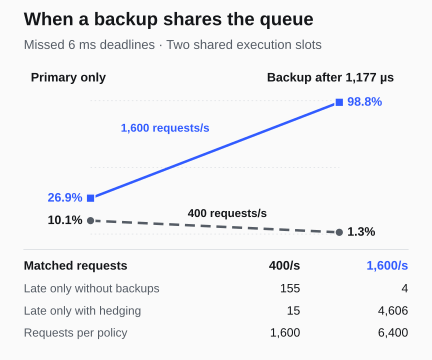

# Racecurve

**When should you launch a backup request?** Give Racecurve a deadline, a duplicate-request budget and a trace. It selects a delay on earlier requests, then estimates deadline misses and backup launches on held-out requests using the recorded service times. Use it before changing a hedging timer for replicated reads, tool calls or inference requests.

[Open the browser explorer](https://huggingface.co/spaces/pgg-engineering/racecurve) · [Get the measured traces](https://huggingface.co/datasets/pgg-engineering/racecurve-hedge-traces)

## Replay the sample

Run the bundled trace with Python 3.10 or later.

```sh
git clone --depth 1 --branch racecurve https://github.com/pgg898200-ship-it/cachepin.git racecurve
cd racecurve
python3 packaging/demo.py
```

The demo chooses a **1,177 µs** delay on the first 700 requests. On the next 300, primary-only replay misses 27 deadlines. The chosen delay misses **0**, with **42 backups**. Replay keeps each attempt's measured service time fixed.

To install the commands in a virtual environment and replay your own trace, run

```sh
python3 -m pip install https://raw.githubusercontent.com/pgg898200-ship-it/cachepin/racecurve/packages/racecurve_tools-0.2.0-py3-none-any.whl
racecurve-demo your-paired-trace.csv --slo-us 6000 --budget-pct 25
```

The wheel includes the example and requires only the Python standard library at runtime. For complete pairs, use the CSV header `primary_us,backup_us` and put one logical request on each row. Preserve each pair, including shared slowdowns. Two independently sampled latency histograms lose that information.

## What happens on real requests?

[](experiments/shared-slots/hedging-under-load.ipynb)

Two replicas shared two execution slots on one host. Every launched copy ran to completion. We matched requests by seed and ID across separate runs with the same offered load and service demands. At 400 requests/s, 155 requests were late only without hedging and 15 were late only with hedging. At 1,600 requests/s, the counts were 4 and 4,606. At the third load, 2,600 requests/s, both policies missed over 98% of deadlines. The notebook lets you change the deadline and recount all 36,800 observations. [Run in Colab](https://colab.research.google.com/github/pgg898200-ship-it/cachepin/blob/racecurve/experiments/shared-slots/hedging-under-load.ipynb) · [Read the executed notebook](experiments/shared-slots/hedging-under-load.ipynb)

| Experiment | Observed outcome |
| --- | --- |
| Prospective localhost HTTP A/B with controlled stalls | At a delay fixed in advance at 1,177 µs, 6 ms deadline misses fell from 80 to 9 in 1,000 matched requests. The client issued 126 backups. Median latency rose from 789 to 810 µs. |
| [Two shared execution slots, 36,800 live requests](experiments/shared-slots/README.md) | The same 1,177 µs delay cut 6 ms misses from 10.1% to 1.3% at 400 requests/s. At 1,600 requests/s it raised misses from 26.9% to 98.8% as backups competed for the shared slots. |
| Independent GPUHedge RunPod and Modal cold-start data | With an initial 25% launch budget, the policy and a simple primary-p95 timer chose the same delay and missed 11 of 36 later deadlines. Primary-only missed the same 11 with zero duplicates. A 10 s delay cut misses to one and launched 11 backups (30.6%). |
| Agreement with upstream GPUHedge replay | Deadline-miss and launch counts matched upstream at every one of 6,002 delay/partition combinations. These were 54 measured request pairs, reused across delays. |

Trace replay holds measured durations fixed. The shared-slot experiment measured separate runs and included queueing and host scheduling. At a different load, a backup can wait for capacity and delay later requests. The published GPU evaluation is retrospective. [Local protocol and raw results](examples/README.md) · [GPU methodology, pinned source and reproduction](external/README.md)

[Compare primary-only, a fixed timer, and the same timer with a live 25% duplicate cap](experiments/shared-slots/budget/README.md). The experiment measures deadline misses and tail latency under identical offered workloads.

## Live aggregation for large fanouts

```sh
make test
./racecurve 6000 1 6001 examples/loopback.csv > curve.csv
```

The native C++17 CLI reads complete pairs or sorted `group,primary_us,backup_us` rows from a file or standard input. For N leaves and K equally spaced delays it ingests the trace in O(N), stores O(K) counters and snapshots all policies in O(K). Each leaf updates a constant number of bins. Group rescue requires every initially late leaf to meet the deadline, so the group cutoff is the smallest rescue cutoff among its late leaves.

It reports launches, leaf misses, all-of fanout misses and idealized time occupied by each attempt. `elapsed_us` sums leaf response times across requests. `backup_us` assumes immediate cancellation at the winner. These are observed-time units; provider billing and server execution after cancellation need separate measurements.

Embed the header in a worker and merge at group boundaries. Each group must live on one worker. Maintain one accumulator per worker, synchronize merges and ensure exactly-once delivery of group updates.

```cpp
#include "src/racecurve.hpp"

racecurve::Curve worker(6000, 1, 6001);
worker.add(7500, 1000);
worker.add(1200, 900);
worker.end_group();
auto policies = worker.results();
auto misses_at_1ms = policies.at(1000).group_misses;
```

Across 10 million generated leaves and 16,384 delays, one worker ingested 85.2 million leaves/s and finalized in 0.147 ms on the test host. This includes generation and excludes CSV, network and service execution. The 200,000-leaf comparison measured 0.918 ms for a fresh 1,024-delay curve versus 409.780 ms for direct replay and 15.756 ms for sort-and-scan from scratch. A prebuilt sorted index wins on repeated queries. Direct replay wins for a single delay. A tuned full-domain histogram won a separate cold build by 1.20× with 33.5× the raw index memory on that workload. [All benchmark code, timings and crossover cases](benchmarks/README.md)

## I only have Prometheus buckets

For a shadow run that recorded both replicas on every request, export the classic histogram counts to bound misses and extra launches. On the GPUHedge holdout, a 10 s timer required exactly 11 launches, but the buckets allowed zero to six deadline misses. [Run the saved Prometheus example](integrations/prometheus.md)

## The primary was canceled. What can the trace tell me?

Racecurve bounds missing service times. Use a winner log or explicit exact, interval, censored and unstarted observations. The Python CLI emits JSON for arbitrary delays. The browser also accepts these three CSV formats for single requests.

```sh
printf 'winner,elapsed_us,old_delay_us\nbackup,8,5\n' | racecurve-bounds - --slo-us 10 --delay-us 5 15
racecurve-otlp integrations/race.otlp.jsonl | racecurve-bounds - --slo-us 10 --delay-us 5 15
```

Timing ties have explicit semantics. The OTLP adapter uses application tags and caller-side dispatch timestamps, and can distinguish the winner decision from loser cleanup. The bounds apply to measured requests with fixed latent service times. [Observation model and proof](BOUNDS.md) · [Instrumentation example](integrations/README.md)

## Choosing the right comparison

- gRPC exposes a per-method hedge delay and controls for attempts. The explorer helps select a candidate setting for one backup. Runtime retries, throttling, headers that suppress hedging, multi-attempt policies and errors can change results. [gRPC hedging guide](https://grpc.io/docs/guides/request-hedging/)
- GPUHedge implements live GPU routing, cancellation receipts and cost analysis. Racecurve accepts complete pairs from its published data and sweeps a delay grid. [GPUHedge](https://github.com/mireklzicar/gpuhedge)
- Queueing models address a different operational question. If a new policy changes the latency distribution, a trace replay alone cannot predict a system-wide benefit. [When to Hedge in Interactive Services](https://www.usenix.org/conference/nsdi21/presentation/primorac)

## Reproduce and contribute

Run `make test`, `python3 external/test_moss.py` and, with Node.js available, `node tests/test_web.cjs`. Use `make bench` for the native baselines. To stage a locally served copy of the browser explorer and source download, run `python3 packaging/build_site.py /tmp/racecurve-site` and `python3 -m http.server --directory /tmp/racecurve-site 8000`. To contribute an independent measurement, share the policy, time units, workload provenance, observed cancellations, calibration split and a reproducible command in the [Space discussions](https://huggingface.co/spaces/pgg-engineering/racecurve/discussions). Aggregates or synthetic fixtures are enough if raw logs are private.

MIT licensed. Third-party trace data retains its upstream license.
